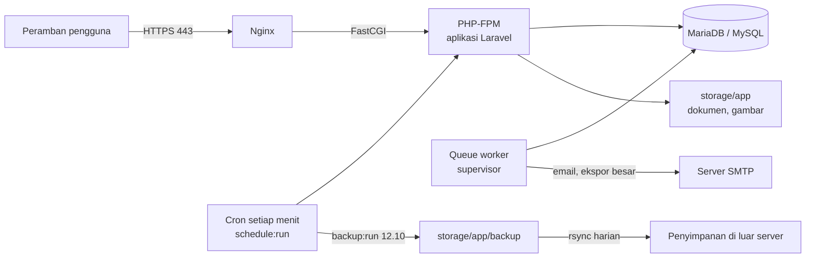

<div align="center">


# Panduan Deploy SINTAS

**Memasang SINTAS di VPS atau server fisik kantor, dari server kosong sampai siap dipakai.**

[Gambaran](#gambaran) · [Pilih jalur](#1-pilih-jalur-vps-atau-server-fisik) · [Siapkan server](#2-siapkan-server) · [Pasang paket](#3-pasang-paket-sistem) · [Pasang aplikasi](#4-pasang-aplikasi) · [Web server dan HTTPS](#6-web-server-dan-https) · [Cron dan worker](#8-cron-dan-queue-worker) · [Cadangan](#10-cadangan-dan-pemulihan) · [Pembaruan](#12-memperbarui-aplikasi) · [Masalah umum](#14-masalah-umum)

</div>

Panduan ini untuk operator server. Semua perintah ditulis untuk **Ubuntu Server 24.04 LTS** dengan **Nginx + PHP-FPM + MariaDB**. Distribusi Debian lain bisa dipakai dengan penyesuaian nama paket. Jalur contoh aplikasi adalah `/var/www/sintas`, nama domain contoh `sintas.contoh.go.id`.

Riwayat keputusan teknis ada di `decisions/catatan-deploy.md` dan `decisions/fase-11.md`.

> [!WARNING]
> `php artisan migrate:fresh`, `migrate:fresh --seed`, dan `migrate:rollback` **tidak pernah** dijalankan di produksi. Perintah itu menghapus seluruh data, termasuk `activity_log`, satu-satunya jejak audit yang wajib disimpan.

## Gambaran

SINTAS butuh lima komponen yang berjalan bersama. Kalau satu mati, sebagian fitur berhenti tanpa pesan galat yang jelas.



| Komponen | Kalau tidak berjalan |
|---|---|
| Nginx + PHP-FPM | Aplikasi tidak dapat dibuka. |
| MariaDB/MySQL | Semua halaman galat 500. |
| Cron `schedule:run` | Cadangan tidak dibuat, angka publik tidak berganti hari, notifikasi harian dan mingguan tidak terkirim. |
| Queue worker | Email tidak terkirim, ekspor besar tetap `menunggu` selamanya. Lonceng di aplikasi tetap tertulis. |
| Salinan cadangan ke luar server | Kerusakan disk menghapus data dan cadangannya sekaligus. |

## 1. Pilih jalur: VPS atau server fisik

Langkah instalasi aplikasi sama untuk keduanya. Perbedaannya ada di persiapan mesin, jaringan, dan HTTPS.

| | VPS (sewa di penyedia cloud) | Server fisik (di ruang server kantor) |
|---|---|---|
| Cocok bila | Aplikasi harus dapat dibuka dari internet, tidak ada ruang server | Data harus tinggal di gedung sendiri, atau aplikasi hanya dipakai di jaringan kantor |
| Listrik, disk, jaringan | Diurus penyedia | Diurus sendiri: UPS, RAID, perawatan |
| Alamat publik | Sudah ada IP publik | Butuh IP publik statis dari ISP dan *port forwarding*, atau hanya LAN |
| HTTPS | Let's Encrypt (gratis, otomatis) | Let's Encrypt bila terjangkau dari internet; sertifikat internal bila hanya LAN |
| Bagian yang dibaca | [2A](#2a-vps) | [2B](#2b-server-fisik) |

### Spesifikasi minimal

| Sumber daya | Minimal | Disarankan | Catatan |
|---|---|---|---|
| CPU | 1 vCPU | 2 vCPU | |
| RAM | 1 GB | 2 GB | Tambah ±512 MB untuk setiap worker ekspor yang berjalan bersamaan. Build aset di server butuh ±1 GB bebas. |
| Disk | 20 GB SSD | 40 GB SSD | Dokumen SPT, SK, gambar di `storage/app`, ditambah cadangan harian (dibatasi 5000 MB). |
| Sistem operasi | Ubuntu Server 24.04 LTS | | |

## 2. Siapkan server

### 2A. VPS

1. **Buat VPS** dengan Ubuntu 24.04 LTS. Pilih pusat data terdekat (Jakarta/Singapura) agar halaman terasa cepat.
2. **Arahkan domain.** Di pengelola DNS domain, buat *A record* `sintas.contoh.go.id` ke IP publik VPS. Periksa dengan `ping sintas.contoh.go.id` setelah beberapa menit.
3. **Masuk sebagai root** lewat SSH, lalu lanjut ke [2C](#2c-langkah-bersama-vps-dan-server-fisik).

### 2B. Server fisik

1. **Siapkan perangkat keras.**
   - Pasang di belakang **UPS**. Mati listrik mendadak saat MariaDB menulis dapat merusak tabel.
   - Pakai dua disk dengan **RAID 1** bila memungkinkan. RAID bukan pengganti cadangan, tetapi menahan satu disk rusak.
   - Di BIOS, aktifkan **"Restore on AC power loss: Power On"** agar server menyala sendiri setelah listrik kembali.
2. **Pasang Ubuntu Server 24.04 LTS** dari USB. Saat instalasi, centang **Install OpenSSH server**. Tidak perlu desktop.
3. **Beri IP statis.** Server yang IP-nya berubah tidak dapat ditemukan pengguna. Ubah `/etc/netplan/50-cloud-init.yaml` (sesuaikan nama antarmuka dari `ip a`, alamat, dan gateway):
   ```yaml
   network:
     version: 2
     ethernets:
       eno1:
         dhcp4: false
         addresses: [192.168.1.20/24]
         routes:
           - to: default
             via: 192.168.1.1
         nameservers:
           addresses: [1.1.1.1, 8.8.8.8]
   ```
   Lalu `sudo netplan apply`. Atau minta admin jaringan membuat reservasi DHCP untuk MAC server.
4. **Tentukan cara akses.** Pilih salah satu:
   - **Hanya jaringan kantor (LAN).** Pengguna membuka `https://sintas.kantor.lan` atau IP server. Buat nama itu di DNS internal/router kantor. HTTPS memakai sertifikat internal ([6C](#6c-https-untuk-jaringan-kantor-saja)).
   - **Dari internet.** Minta IP publik statis ke ISP, buat *port forwarding* port **80** dan **443** di router kantor ke IP server, lalu buat *A record* domain ke IP publik itu. HTTPS memakai Let's Encrypt ([6B](#6b-https-dengan-lets-encrypt)).

> [!CAUTION]
> Jangan meneruskan port 22 (SSH) atau 3306 (MariaDB) dari router ke internet. Akses SSH dari luar kantor sebaiknya lewat VPN.

5. **Server yang hanya menyala di jam kerja.** Laptop atau PC yang dinyalakan 08.00 dan dimatikan 16.00 boleh dipakai.
   - Nyalakan sebelum 08.30. Tugas terjadwal berjalan 08.30 sampai 12.40 ([8](#8-cron-dan-queue-worker)).
   - Matikan dengan `sudo systemctl poweroff`. Jangan mencabut daya.
   - Pastikan cron dan supervisor berjalan otomatis saat boot. `systemctl is-enabled cron supervisor` harus menampilkan `enabled` untuk keduanya.
   - Nonaktifkan suspend dan hibernate:
     ```bash
     sudo systemctl mask sleep.target suspend.target hibernate.target hybrid-sleep.target
     ```
     Untuk laptop, abaikan tutup layar: set `HandleLidSwitch=ignore` di `/etc/systemd/logind.conf`, lalu `sudo systemctl restart systemd-logind`.
   - Halaman publik dan login tidak dapat dibuka di luar jam itu.
   - Salinan cadangan ke luar mesin ([10](#salin-ke-luar-server)) wajib. Cron rsync pukul 03.00 tidak akan menemukan server menyala, jadi jadwalkan setelah 12.10 di jam kerja (mis. 13.00).

### 2C. Langkah bersama VPS dan server fisik

Jalankan sebagai root atau dengan `sudo`.

1. **Perbarui sistem dan aktifkan pembaruan keamanan otomatis:**
   ```bash
   apt update && apt upgrade -y
   apt install -y unattended-upgrades && dpkg-reconfigure -plow unattended-upgrades
   ```
2. **Buat pengguna aplikasi** (pemilik kode, bukan root) dan beri akses `sudo`:
   ```bash
   adduser sintas
   usermod -aG sudo sintas
   ```
   Salin kunci SSH Anda ke pengguna ini (`ssh-copy-id sintas@<ip-server>` dari komputer Anda), lalu masuk ulang sebagai `sintas`.
3. **Pasang firewall.** Hanya SSH, HTTP, dan HTTPS yang dibuka:
   ```bash
   sudo ufw allow OpenSSH
   sudo ufw allow 80/tcp
   sudo ufw allow 443/tcp
   sudo ufw enable
   ```
4. **Pastikan jam server akurat.** Penomoran, status SPT, dan jadwal bergantung pada tanggal. Zona waktu server boleh apa saja (aplikasi memakai `Asia/Jakarta` sendiri), tetapi jamnya harus sinkron:
   ```bash
   sudo timedatectl set-ntp true
   timedatectl   # "System clock synchronized: yes"
   ```

## 3. Pasang paket sistem

### PHP 8.5.12 atau lebih baru

Ubuntu 24.04 belum membawa PHP 8.5, jadi pakai repositori `ondrej/php`:

```bash
sudo add-apt-repository -y ppa:ondrej/php
sudo apt update
sudo apt install -y php8.5-fpm php8.5-cli php8.5-mysql php8.5-mbstring php8.5-xml \
  php8.5-bcmath php8.5-zip php8.5-gd php8.5-intl php8.5-curl
```

Periksa versi dan ekstensi. Aplikasi menolak berjalan di PHP lebih lama dari 8.5.12:

```bash
php -v                                              # PHP 8.5.12 atau lebih baru
php -m | grep -Ei 'pdo_mysql|mbstring|openssl|tokenizer|xml|ctype|fileinfo|bcmath|zip|gd|exif|intl'
php -r 'var_dump(function_exists("imagewebp"));'    # bool(true)
```

| Ekstensi | Dipakai untuk |
|---|---|
| `gd` dengan WebP | Gambar slide dan foto profil diubah ke WebP. |
| `exif` | Foto ponsel diputar sesuai orientasi sebelum dipotong. |
| `zip` | Ekspor Excel dan arsip cadangan. |
| `intl`, `mbstring` | Tanggal dan teks Bahasa Indonesia. |

### Nginx, MariaDB, dan alat pendukung

```bash
sudo apt install -y nginx mariadb-server mariadb-client supervisor git unzip p7zip-full acl
sudo mysql_secure_installation   # set kata sandi root, hapus pengguna anonim dan basis "test"
```

`mariadb-client` memberi `mariadb-dump` untuk cadangan. `p7zip-full` dibutuhkan untuk membuka cadangan terenkripsi. `acl` dipakai untuk izin folder di langkah 4.

MySQL 8 juga didukung (`apt install mysql-server`). Pastikan biner dump cocok dengan `DB_CONNECTION` (lihat [Konfigurasi .env](#5-konfigurasi-env)).

### Composer 2

```bash
cd ~
curl -sS https://getcomposer.org/installer -o composer-setup.php
sudo php composer-setup.php --install-dir=/usr/local/bin --filename=composer
rm composer-setup.php
composer --version
```

### Node.js 24 (hanya untuk build aset)

Aset CSS/JS (`public/build`) tidak ikut repo, jadi harus dibangun. Node.js 24.22.1 atau lebih baru (24.x) cukup ada di mesin yang menjalankan build. Server produksi tidak butuh Node saat aplikasi berjalan.

- **Paling mudah:** pasang Node di server dan build di sana.
- **Server ber-RAM kecil:** build di komputer lain, lalu salin folder `public/build` ke server (`rsync -a public/build/ sintas@server:/var/www/sintas/public/build/`).

Pasang lewat `nvm` sebagai pengguna `sintas` (versi dibaca dari `.nvmrc` di repo):

```bash
curl -o- https://raw.githubusercontent.com/nvm-sh/nvm/v0.40.3/install.sh | bash
source ~/.bashrc
nvm install 24.22.1
node -v
```

## 4. Pasang aplikasi

Jalankan sebagai pengguna `sintas`.

### 4.1 Ambil kode dan dependensi

```bash
sudo mkdir -p /var/www/sintas && sudo chown sintas:sintas /var/www/sintas
git clone --branch main https://github.com/andhika-tama/Sintas.git /var/www/sintas
cd /var/www/sintas
composer install --no-dev --optimize-autoloader
npm ci && npm run build
```

> [!NOTE]
> `composer install` sengaja gagal bila PHP di server lebih lama dari 8.5.12 (platform check). Perbarui PHP dulu, jangan pakai `--ignore-platform-reqs`.

### 4.2 Buat basis data

```bash
sudo mariadb
```

```sql
CREATE DATABASE sintas CHARACTER SET utf8mb4 COLLATE utf8mb4_unicode_ci;
CREATE USER 'sintas'@'localhost' IDENTIFIED BY '<kata-sandi-kuat>';
GRANT ALL PRIVILEGES ON sintas.* TO 'sintas'@'localhost';
FLUSH PRIVILEGES;
EXIT;
```

Pakai pengguna khusus ini di aplikasi, jangan root. MariaDB bawaan Ubuntu hanya mendengarkan `127.0.0.1`; biarkan begitu.

### 4.3 Isi `.env`

```bash
cp .env.example .env
nano .env
```

Ubah minimal kunci berikut. Penjelasan lengkap tiap kunci ada di [bagian 5](#5-konfigurasi-env).

```dotenv
APP_ENV=production
APP_DEBUG=false
APP_URL=https://sintas.contoh.go.id

DB_CONNECTION=mariadb
DB_HOST=127.0.0.1
DB_PORT=3306
DB_DATABASE=sintas
DB_USERNAME=sintas
DB_PASSWORD=<kata-sandi-kuat>

SESSION_SECURE_COOKIE=true
CACHE_STORE=database
QUEUE_CONNECTION=database
LOG_LEVEL=warning

MAIL_MAILER=smtp
MAIL_HOST=smtp.penyedia.id
MAIL_PORT=587
MAIL_USERNAME=<pengguna>
MAIL_PASSWORD=<kata-sandi>
MAIL_SCHEME=null
MAIL_FROM_ADDRESS="sintas@contoh.go.id"
MAIL_FROM_NAME="SINTAS"

BACKUP_MAIL_TO=operator@contoh.go.id
BACKUP_ARCHIVE_PASSWORD=<kata-sandi-panjang-acak>
```

> [!IMPORTANT]
> `APP_ENV=production` harus sudah terisi **sebelum** `db:seed`. Di lingkungan lain seeder demo ikut berjalan dan gagal dengan `Call to undefined function fake()` karena paket pengembangan tidak terpasang.

Batasi agar `.env` hanya dapat dibaca pemilik dan web server:

```bash
chmod 640 .env && sudo chgrp www-data .env
```

### 4.4 Kunci aplikasi, migrasi, dan data rujukan

```bash
php artisan key:generate --force
php artisan migrate --force
php artisan db:seed --force
```

- **`APP_KEY`**: salin nilainya dari `.env` ke tempat aman di luar server (pengelola kata sandi kantor). Kehilangan kunci ini membuat sesi dan tautan bertanda tangan tidak valid. Jangan pernah menggantinya setelah aplikasi dipakai.
- **Seeder produksi** hanya menulis Irban, Objek, dan Jenis Penugasan. Klasifikasi datang dari migrasi. Tidak ada akun, PKPT, atau SPT yang dibuat.

> [!IMPORTANT]
> Nama Objek dan Jenis Penugasan bawaan hanya **contoh**. Ganti dengan data sebenarnya lewat menu Admin sebelum aplikasi dipakai.

### 4.5 Admin pertama

```bash
php artisan sintas:buat-admin <username> --nama="<Nama Lengkap>" --email=<email>
```

Kata sandi ditanyakan dua kali tanpa ditampilkan, dan tidak masuk riwayat shell maupun log. Jalankan di terminal interaktif. Syarat: minimal 8 karakter, ada huruf besar, huruf kecil, dan angka. Akun ini tidak wajib ganti kata sandi karena operator memilihnya sendiri.

### 4.6 Penyimpanan dan izin folder

```bash
php artisan storage:link
```

Gambar slide dan foto profil dilayani lewat `public/storage`. Tanpa tautan ini gambar beranda dan foto profil tidak tampil.

Folder `storage` dan `bootstrap/cache` ditulis oleh dua pengguna: `www-data` (web, worker, cron) dan `sintas` (perintah manual, `composer`). ACL memberi keduanya hak tulis, termasuk untuk berkas yang dibuat kemudian:

```bash
cd /var/www/sintas
sudo setfacl -R  -m u:www-data:rwX -m u:sintas:rwX storage bootstrap/cache
sudo setfacl -dR -m u:www-data:rwX -m u:sintas:rwX storage bootstrap/cache
```

`storage/app/private` berisi dokumen SPT dan tidak boleh berada di bawah `public/`. Struktur bawaan repo sudah benar; jangan dipindah.

### 4.7 Cache konfigurasi

```bash
php artisan optimize
```

Jalankan ulang setiap kali `.env` berubah, disusul `php artisan queue:restart`.

Lanjutkan ke [web server](#6-web-server-dan-https), [batas PHP](#7-batas-php-dan-mitigasi-keamanan), [cron dan worker](#8-cron-dan-queue-worker), lalu [pemeriksaan](#11-pemeriksaan-setelah-deploy).

## 5. Konfigurasi .env

Hanya kunci yang dibaca aplikasi dan berbeda dari bawaan Laravel atau `.env.example`.

| Kunci | Nilai produksi | Keterangan |
|---|---|---|
| `APP_NAME` | `SINTAS` | Juga menjadi nama folder cadangan. |
| `APP_ENV` | `production` | Menentukan seeder produksi dan penjaga seeder demo. |
| `APP_DEBUG` | `false` | Wajib `false`. Nilai `true` menampilkan jejak galat dan isi konfigurasi ke pengunjung. |
| `APP_URL` | `https://alamat-publik` | Harus alamat yang dibuka pengguna, dengan https. Tombol di email dan tautan verifikasi memakai nilai ini; alamat salah membuat pengguna mendapat 403. |
| `APP_KEY` | dari `key:generate` | Jangan diganti setelah dipakai. |
| `APP_LOCALE` / `APP_TIMEZONE` | `id` / `Asia/Jakarta` | Jangan diubah. Jadwal, tanggal, dan penomoran memakai zona Jakarta. |
| `DB_CONNECTION` | `mariadb` atau `mysql` | `mariadb` memanggil `mariadb-dump` saat cadangan, `mysql` memanggil `mysqldump`. |
| `DB_HOST` `DB_PORT` `DB_DATABASE` `DB_USERNAME` `DB_PASSWORD` | sesuai server | Pengguna khusus, bukan root. |
| `DB_DUMP_BINARY_PATH` | kosong | Isi dengan folder berisi `mysqldump`/`mariadb-dump` hanya bila biner itu tidak ada di PATH. |
| `SESSION_DRIVER` | `database` | Bawaan `.env.example`. |
| `SESSION_SECURE_COOKIE` | `true` | Setelah HTTPS aktif. Tanpa HTTPS, nilai `true` membuat login gagal terus. |
| `CACHE_STORE` | `database` atau `redis` | **Wajib dibagi antarproses**, bukan `array`. Dipakai kunci penomoran per tahun, pembatas laju, dan cache angka publik. |
| `QUEUE_CONNECTION` | `database` | Email dan ekspor besar lewat antrean. |
| `DB_QUEUE_RETRY_AFTER` | `660` atau hapus barisnya | Harus lebih besar dari batas waktu job ekspor (600 detik). `.env` lama bernilai `90` merusak ekspor besar. |
| `MAIL_MAILER` | `smtp` | `log` hanya menulis email ke `storage/logs` (untuk gladi, butuh `LOG_LEVEL=debug`). |
| `MAIL_HOST` `MAIL_PORT` `MAIL_USERNAME` `MAIL_PASSWORD` `MAIL_SCHEME` `MAIL_FROM_ADDRESS` `MAIL_FROM_NAME` | sesuai penyedia | `MAIL_SCHEME=smtps` untuk port 465; `null` untuk STARTTLS di port 587. |
| `TRUSTED_PROXIES` | lihat [6D](#6d-di-belakang-proxy-atau-load-balancer) | Kosong bila Nginx langsung menerima pengunjung. Isi IP proxy bila ada proxy/load balancer di depan Nginx. |
| `BACKUP_MAIL_TO` | alamat email | Penerima laporan cadangan. Kosong = tanpa notifikasi. Alamat tidak valid membuat perintah cadangan gagal. |
| `BACKUP_ARCHIVE_PASSWORD` | kata sandi panjang acak | Sangat disarankan. Zip cadangan berisi hash kata sandi, NIP, dan PDF SPT, dan disalin ke luar server. Dienkripsi AES-256. Simpan bersama `APP_KEY`: tanpa kata sandi ini cadangan tidak dapat dipulihkan. Kosong = zip tidak terenkripsi. |
| `LOG_LEVEL` | `warning` | `debug` hanya untuk gladi/lokal. |

## 6. Web server dan HTTPS

### 6A. Server block Nginx

Buat `/etc/nginx/sites-available/sintas` (ganti `server_name`):

```nginx
server {
    listen 80;
    server_name sintas.contoh.go.id;
    root /var/www/sintas/public;
    index index.php;
    client_max_body_size 13m;

    location / {
        try_files $uri $uri/ /index.php?$query_string;
    }

    location ~ \.php$ {
        include fastcgi_params;
        fastcgi_param SCRIPT_FILENAME $realpath_root$fastcgi_script_name;
        fastcgi_pass unix:/run/php/php8.5-fpm.sock;
        fastcgi_read_timeout 300;
    }

    location ~ /\.(?!well-known) {
        deny all;
    }
}
```

Aktifkan dan matikan situs bawaan:

```bash
sudo ln -s /etc/nginx/sites-available/sintas /etc/nginx/sites-enabled/
sudo rm /etc/nginx/sites-enabled/default
sudo nginx -t && sudo systemctl reload nginx
```

- `root` harus `public/`, bukan folder aplikasi. Mengarahkan ke folder aplikasi membuka `.env` ke internet.
- `client_max_body_size 13m` selaras dengan batas unggah aplikasi 12 MB.
- `fastcgi_read_timeout 300` dibutuhkan impor SPT data lama yang berjalan sinkron.
- Aplikasi sudah mengirim `X-Frame-Options`, `X-Content-Type-Options`, `Referrer-Policy`, dan `Permissions-Policy`. Jangan tambahkan header yang sama dengan nilai berbeda di Nginx. Belum ada CSP.

Lalu pasang HTTPS dengan salah satu cara di bawah.

### 6B. HTTPS dengan Let's Encrypt

Untuk VPS, atau server fisik yang port 80 dan 443-nya dapat dijangkau dari internet:

```bash
sudo apt install -y certbot python3-certbot-nginx
sudo certbot --nginx -d sintas.contoh.go.id --redirect
```

Certbot menambahkan blok `listen 443 ssl`, mengalihkan http ke https, dan memperbarui sertifikat otomatis. Uji pembaruan dengan `sudo certbot renew --dry-run`.

### 6C. HTTPS untuk jaringan kantor saja

Let's Encrypt tidak dapat memverifikasi server yang tidak terjangkau internet. Pakai sertifikat internal:

1. Buat sertifikat (berlaku 2 tahun; ganti nama dan IP):
   ```bash
   sudo openssl req -x509 -nodes -newkey rsa:2048 -days 730 \
     -keyout /etc/ssl/private/sintas.key -out /etc/ssl/certs/sintas.crt \
     -subj "/CN=sintas.kantor.lan" \
     -addext "subjectAltName=DNS:sintas.kantor.lan,IP:192.168.1.20"
   ```
2. Di server block, ganti `listen 80;` dengan:
   ```nginx
   listen 443 ssl;
   ssl_certificate     /etc/ssl/certs/sintas.crt;
   ssl_certificate_key /etc/ssl/private/sintas.key;
   ```
   dan tambahkan blok pengalih:
   ```nginx
   server {
       listen 80;
       server_name sintas.kantor.lan;
       return 301 https://$host$request_uri;
   }
   ```
3. `sudo nginx -t && sudo systemctl reload nginx`.
4. Pasang `sintas.crt` sebagai *trusted root* di komputer pengguna (lewat Group Policy bila ada domain Windows), agar peramban tidak memberi peringatan. Bila kantor punya CA internal, minta sertifikat dari CA itu saja.

Setelah HTTPS aktif, setel HSTS di Nginx bila sudah yakin stabil: `add_header Strict-Transport-Security "max-age=31536000" always;`.

### 6D. Di belakang proxy atau load balancer

Bila Nginx di server ini **langsung** menerima pengunjung (susunan di atas), biarkan `TRUSTED_PROXIES` kosong. PHP-FPM sudah menerima IP klien dan status https dari Nginx.

Bila ada **proxy lain di depan** (load balancer penyedia cloud, reverse proxy kantor, Nginx di mesin lain):

- Isi `TRUSTED_PROXIES` dengan IP atau CIDR proxy itu, dipisah koma. Gunakan `127.0.0.1` bila proxy itu ada di mesin yang sama dan meneruskan lewat HTTP.
- Proxy harus meneruskan header berikut:
  ```nginx
  proxy_set_header Host $host;
  proxy_set_header X-Forwarded-For $proxy_add_x_forwarded_for;
  proxy_set_header X-Forwarded-Proto $scheme;
  proxy_set_header X-Forwarded-Host $host;
  ```
- Tanpa pengaturan ini, `activity_log.ip` mencatat alamat proxy, pembatas laju "per IP" berlaku untuk semua orang sekaligus, dan aplikasi menyangka permintaan http.

> [!CAUTION]
> `TRUSTED_PROXIES=*` hanya untuk proxy yang alamatnya berubah-ubah, dan hanya bila server aplikasi tidak dapat dijangkau langsung selain lewat proxy. Kalau dapat, siapa pun bisa mengirim `X-Forwarded-For` palsu: pembatas laju publik dilewati dan `activity_log.ip` dipalsukan.

Pembatas laju yang terpengaruh: halaman publik 120/menit per IP, login 5/menit per nama pengguna+IP, ekspor 10/menit per pengguna, ganti email 3 per 10 menit.

## 7. Batas PHP dan mitigasi keamanan

### Batas PHP-FPM

Ubah `/etc/php/8.5/fpm/php.ini`:

```ini
upload_max_filesize = 13M
post_max_size = 13M
memory_limit = 256M
max_execution_time = 300
session.upload_progress.enabled = 0
```

Dan di `/etc/php/8.5/fpm/pool.d/www.conf`:

```ini
request_terminate_timeout = 300
```

Lalu `sudo systemctl restart php8.5-fpm`.

| Pengaturan | Alasan |
|---|---|
| `upload_max_filesize`, `post_max_size` 13M | Batas unggah aplikasi maksimal 12 MB (batas sementara Livewire); impor `.xlsx` 5 MB; gambar slide 5 MB. |
| `memory_limit` 256M | Ekspor dan pemrosesan gambar menaikkannya sendiri ke 512M lewat `ini_set`. Jangan masukkan `ini_set` ke `disable_functions` dan jangan pasang `php_admin_value` yang lebih rendah. |
| `max_execution_time`, `request_terminate_timeout` 300 | Impor SPT data lama berjalan sinkron dalam satu permintaan (maks 2000 baris per berkas). |

### Mitigasi CVE-2026-115560

PHP 8.5.12 belum memperbaiki CVE-2026-115560. Sampai rilis PHP berikutnya, `session.upload_progress.enabled` harus `0` (sudah ada di `php.ini` di atas).

- Repo juga memuatnya di `public/.user.ini` (berlaku untuk PHP-FPM/CGI, dibaca ulang tiap `user_ini.cache_ttl`, default 300 detik). Hapus berkas itu setelah PHP merilis perbaikan.
- Atur juga di `/etc/php/8.5/cli/php.ini` untuk CLI.
- Cek CLI: `php -r 'var_dump(ini_get("session.upload_progress.enabled"));'` harus `string(1) "0"`. Ini tidak membuktikan PHP-FPM.
- Cek PHP-FPM: buat `public/cek-ini.php` berisi `<?php var_dump(ini_get('session.upload_progress.enabled'));`, buka di peramban (harus `string(1) "0"`), lalu **hapus segera**.
- Apache mod_php mengabaikan `.user.ini`: pakai `php_admin_value` di vhost atau ubah `php.ini`.

## 8. Cron dan queue worker

### Cron untuk scheduler

Cron dan worker berjalan sebagai `www-data`, sama dengan web server, agar berkas yang dibuat dapat dibaca semua proses:

```bash
sudo crontab -u www-data -e
```

Tambahkan satu baris:

```cron
* * * * * cd /var/www/sintas && php artisan schedule:run >> /dev/null 2>&1
```

Cek dengan `php artisan schedule:list`. Harus ada delapan pekerjaan:

| Waktu (WIB) | Pekerjaan | Fungsi |
|---|---|---|
| Setiap hari 00.00 | `publik:segarkan` (closure terjadwal) | Mengganti hari pada angka publik ("Hari ini", status). |
| Setiap hari 08.30 | `ekspor:bersihkan` | Hapus file ekspor berumur lebih dari 7 hari. |
| Setiap hari 08.35 | `cache:pangkas` (closure terjadwal) | Dengan `CACHE_STORE=database`, menghapus baris `cache`/`cache_locks` kedaluwarsa. Tanpa efek untuk `redis`. |
| Setiap hari 08.40 | `notifikasi:harian` | SPT Terlambat, pengingat SPT final, pengingat Perubahan PKPT. |
| Senin 08.45 | `notifikasi:ringkasan-mingguan` | Ringkasan mingguan ke Pimpinan. |
| Setiap hari 12.00 | `backup:clean` | Hapus cadangan lama sesuai retensi. |
| Setiap hari 12.10 | `backup:run` | Cadangan basis data dan berkas. |
| Setiap hari 12.40 | `backup:monitor` | Memeriksa cadangan terbaru ada dan sehat. |

Scheduler tidak mengejar jadwal yang terlewat. Karena itu semua tugas kecuali `publik:segarkan` dijadwalkan antara 08.30 dan 12.40, agar server yang hanya menyala di jam kantor tetap menjalankannya. Server harus sudah menyala sebelum 08.30. Bila server mati di hari libur atau akhir pekan, tidak ada cadangan hari itu, dan ringkasan Senin yang jatuh di hari libur tidak dikirim.

> [!IMPORTANT]
> Memasang SINTAS pada basis data yang **sudah berisi SPT** (pindahan server lama)? Baca dulu butir "Scheduler pertama kali" di [Migrasi khusus](#13-migrasi-khusus) sebelum memasang cron, agar pengguna tidak dibanjiri notifikasi.

### Queue worker dengan supervisor

Buat `/etc/supervisor/conf.d/sintas-worker.conf`:

```ini
[program:sintas-worker]
command=php /var/www/sintas/artisan queue:work --sleep=3 --tries=3 --max-time=3600 --timeout=600 --memory=512
directory=/var/www/sintas
user=www-data
autostart=true
autorestart=true
stopasgroup=true
killasgroup=true
numprocs=1
redirect_stderr=true
stdout_logfile=/var/www/sintas/storage/logs/worker.log
stopwaitsecs=3660
```

Aktifkan:

```bash
sudo supervisorctl reread
sudo supervisorctl update
sudo supervisorctl start sintas-worker:*
sudo supervisorctl status            # sintas-worker ... RUNNING
```

- `--timeout=600` mengikuti batas job ekspor. `DB_QUEUE_RETRY_AFTER` (660) harus tetap lebih besar.
- `--memory=512` menyelaraskan batas restart worker dengan kebutuhan ekspor. Bawaan 128 MB membuat worker berhenti setelah satu ekspor besar.
- Ekspor yang selalu lewat antrean: PDF lebih dari 200 baris (dompdf ±0,26 MB per baris) dan xlsx lebih dari 1.000 baris.
- `numprocs=1` cukup untuk satu kantor. Menambah worker berarti menambah ±512 MB RAM per worker.

<details>
<summary>Tanpa supervisor (hosting terbatas)</summary>

Tambahkan cron setiap menit sebagai pengganti:

```cron
* * * * * cd /var/www/sintas && flock -n storage/framework/queue.lock php artisan queue:work --stop-when-empty --max-time=55 --timeout=600 --memory=512 >> /dev/null 2>&1
```

`flock -n` mencegah worker bertumpuk: satu job ekspor dapat berjalan hingga 600 detik, melewati `--max-time=55`, dan tanpa kunci cron berikutnya menyalakan worker kedua setiap menit. Bila `flock` tidak tersedia, minta penyedia mengaktifkan supervisor.

</details>

## 9. Email (SMTP)

1. Isi `MAIL_*` di `.env` (lihat [bagian 5](#5-konfigurasi-env)). Gunakan akun SMTP resmi kantor atau layanan pengiriman email; Gmail pribadi sering memblokir pengiriman massal.
2. Pastikan `APP_URL` adalah alamat yang dibuka pengguna. Tombol di email dan tautan verifikasi memakai nilai ini.
3. `php artisan optimize && php artisan queue:restart`.
4. Uji kirim:
   ```bash
   php artisan tinker --execute="Mail::raw('uji', fn(\$m) => \$m->to('alamat@anda.id')->subject('Uji SINTAS'));"
   ```
   Periksa kotak masuk dan folder spam. Email aplikasi sendiri dikirim lewat antrean, jadi worker harus berjalan.
5. Pegawai tanpa alamat email tidak menerima pemberitahuan. Isi email pegawai lewat menu Pegawai atau impor.

## 10. Cadangan dan pemulihan

### Apa, di mana, kapan

| | |
|---|---|
| **Isi** | Dump basis data (termasuk `activity_log`), `storage/app/private` (dokumen SPT, SK Perubahan PKPT; tanpa `ekspor/` dan `livewire-tmp/`), dan `storage/app/public` (slide, foto profil). |
| **Tidak ikut** | `.env` dan kode. Tabel `cache`, `cache_locks`, `sessions`, `jobs` (isinya sementara). |
| **Lokasi** | `storage/app/backup/SINTAS/sintas-<tanggal>.zip`. Tidak publik. Jalur di dalam zip relatif terhadap folder aplikasi. |
| **Jadwal** | `backup:clean` 12.00, `backup:run` 12.10, `backup:monitor` 12.40 WIB. |
| **Retensi** | Semua cadangan 7 hari, satu per hari 30 hari, satu per pekan 8 pekan, satu per bulan 12 bulan. Tertua dihapus bila total lebih dari 5000 MB. |
| **Laporan** | Email sukses/gagal/tidak sehat ke `BACKUP_MAIL_TO`. |

Jalankan sekali setelah instalasi dan pastikan hasilnya `Healthy`:

```bash
sudo -u www-data php artisan backup:run
php artisan backup:list
```

`activity_log` hanya bertambah (±230 B per baris), jadi pantau ukuran cadangan dari waktu ke waktu.

### Salin ke luar server

Cadangan di disk yang sama tidak melindungi dari disk rusak, server dicuri, atau VPS dihapus. Salin setiap hari ke mesin lain. Contoh cron pukul 03.00 di mesin cadangan (NAS kantor, server lain):

```cron
0 3 * * * rsync -a sintas@<ip-server>:/var/www/sintas/storage/app/backup/ /cadangan/sintas/
```

Untuk server yang hanya menyala di jam kerja, ganti jadwalnya menjadi `0 13 * * 1-5`.

Untuk server fisik, simpan salinan di lokasi lain dari gedung yang sama (mis. penyimpanan objek awan atau kantor lain). Untuk VPS, salinan ke NAS kantor sudah memenuhi.

### Pulihkan

Lakukan di server yang sudah terpasang sesuai [bagian 4](#4-pasang-aplikasi), dengan kode versi yang sama dengan cadangan.

1. **Ekstrak** ke folder sementara. Zip terenkripsi AES-256 tidak dapat dibuka `unzip`, pakai `7z` dan masukkan `BACKUP_ARCHIVE_PASSWORD`:
   ```bash
   mkdir /tmp/pulih
   7z x -o/tmp/pulih storage/app/backup/SINTAS/sintas-<tanggal>.zip
   ```
   Zip tanpa sandi dapat dibuka `unzip ... -d /tmp/pulih`. Zip buatan Windows memakai `\` pada nama entri dan perlu alat yang menormalkannya.
2. **Basis data.** Bila basis `sintas` masih kosong, jalankan dulu `php artisan migrate --force` agar tabel yang tidak ikut dump ada. Lalu muat dump (dump mengganti tabel lain beserta isinya, termasuk `migrations`):
   ```bash
   mariadb -u sintas -p sintas < /tmp/pulih/db-dumps/<berkas>.sql
   ```
3. **Berkas.** Salin dari akar ekstraksi ke akar aplikasi. Ini hanya menambahkan `private/` dan `public/`; jangan timpa `storage/app/backup`:
   ```bash
   cp -a /tmp/pulih/storage/app/. /var/www/sintas/storage/app/
   ```
4. **Pulihkan `.env`** dari simpanan Anda (terutama `APP_KEY` yang sama), lalu:
   ```bash
   sudo setfacl -R  -m u:www-data:rwX -m u:sintas:rwX storage bootstrap/cache
   sudo setfacl -dR -m u:www-data:rwX -m u:sintas:rwX storage bootstrap/cache
   php artisan storage:link
   php artisan optimize:clear && php artisan optimize
   ```
5. **Periksa:** masuk, buka satu SPT dan unduh dokumennya, buka `/jadwal`.
6. **Hapus `/tmp/pulih`.** Isinya data pribadi.

Setelah pemulihan pengguna harus masuk ulang, dan job antrean yang belum jalan hilang (ekspor dapat diminta lagi).

> [!TIP]
> Uji pemulihan sekali sebelum go-live dan berkala (mis. tiap kuartal) ke basis data sementara. Cadangan yang tidak pernah dipulihkan belum terbukti bisa dipakai.

## 11. Pemeriksaan setelah deploy

- [ ] `curl -sI https://alamat-publik/` mengembalikan `200`, dengan header `X-Frame-Options` dan `X-Content-Type-Options`.
- [ ] `https://alamat-publik/tidak-ada` menampilkan halaman 404 SINTAS tanpa jejak galat.
- [ ] `/`, `/jadwal`, `/realisasi` terbuka tanpa login dan gambar slide tampil.
- [ ] Login Admin berhasil; menu Profil menyimpan foto (GD/WebP/exif).
- [ ] `php artisan about` menunjukkan `Environment production`, `Debug mode OFF`, `Cache database`/`redis`, `Queue database`, `Maintenance mode OFF`.
- [ ] `php artisan schedule:list` menunjukkan delapan pekerjaan; `php artisan schedule:run` tidak galat.
- [ ] `sudo supervisorctl status` menunjukkan `sintas-worker` RUNNING. Ekspor Register lebih dari 1.000 baris (atau PDF lebih dari 200 baris) selesai dan notifikasi `File ekspor siap` muncul.
- [ ] Email uji sampai ke kotak masuk.
- [ ] `backup:run` sukses, `backup:list` menunjukkan `Healthy`, zip memuat `db-dumps/` dan `storage/app/private/`. Salinan ke luar server berjalan.
- [ ] Pemulihan diuji sekali ke basis sementara.
- [ ] Baris terbaru di menu Log Aktivitas berisi IP komputer Anda, bukan IP proxy.
- [ ] `session.upload_progress.enabled` bernilai `0` di PHP-FPM.
- [ ] Nama Objek dan Jenis Penugasan contoh sudah diganti data sebenarnya.
- [ ] Tidak ada akun demo (kata sandi `password`) di menu Pengguna.
- [ ] `APP_KEY` dan `BACKUP_ARCHIVE_PASSWORD` tersimpan di luar server.

## 12. Memperbarui aplikasi

Lakukan di jendela rilis (di luar jam kerja), dari `/var/www/sintas` sebagai `sintas`:

```bash
sudo -u www-data php artisan backup:run   # 1. cadangan dulu, wajib bila ada migrasi baru
php artisan down --retry=60               # 2. mode perawatan
git pull --ff-only                        # 3. ambil kode baru
composer install --no-dev --optimize-autoloader
npm ci && npm run build                   # atau salin public/build dari mesin build
php artisan migrate --force
php artisan optimize
php artisan queue:restart                 # worker memuat kode baru
php artisan up
```

Lalu jalankan [pemeriksaan setelah deploy](#11-pemeriksaan-setelah-deploy) yang relevan.

- `composer install` sengaja gagal bila PHP di server lebih lama dari 8.5.12. Perbarui PHP dulu (`sudo apt upgrade`).
- Jangan menjalankan `migrate:rollback` atau `migrate:fresh` di produksi. Bila rilis bermasalah, pulihkan dari cadangan langkah 1.

## 13. Migrasi khusus

- **Migrasi revisi jadwal (Fase 9.2).** `2026_11_20_000020_migrasi_revisi_jadwal` mengubah isi `pkpt_item_revisi` menjadi paket Perubahan (`sumber = migrasi_revisi`) dan Usulan, lalu menghapus tabel lama. **Tidak dapat dibalik.** Pada basis yang sudah berisi data lama: cadangkan sebelum `migrate`, jalankan di jendela rilis, jangan rollback. Instalasi baru tidak terpengaruh.
- **Batas unggah.** `2026_12_01_000001_batasi_upload_maks_mb` menjepit nilai `upload.maks_mb` tersimpan yang lebih dari 12 menjadi 12 (aman dijalankan ulang).
- **Scheduler pertama kali pada basis yang sudah berisi SPT.** `notifikasi:harian` pertama akan mengirim notifikasi untuk setiap SPT yang sudah Terlambat atau lewat 3 hari tanpa SPT final. Sebelum memasang cron, isi kolom idempotensi:
  ```sql
  UPDATE spt SET terlambat_diberitahu_pada = NOW(), pengingat_final_pada = NOW()
  WHERE status_pengajuan = 'diterima' AND ditandai_selesai_pada IS NULL;
  ```
  Saring per kondisi bila pengingat untuk SPT tertentu tetap diinginkan. Instalasi baru tidak perlu.
- **Impor SPT data lama.** Bila hasil impor memperingatkan `Nomor urut {n} melebihi nomor terakhir register {tahun}`, atur `Nomor awal` di Register untuk tahun berjalan sebelum menerbitkan nomor baru. Impor berjalan sinkron, maks 2000 baris dan 5 MB per berkas `.xlsx`, tanpa notifikasi.
- **Log aktivitas.** `activity_log` tidak boleh dihapus (PRD §7.12). `php artisan activitylog:clean` sengaja menolak dengan kode keluar 1. Jangan menghapus baris secara manual; pengarsipan dilakukan lewat cadangan.

## 14. Masalah umum

| Gejala | Penyebab paling mungkin | Perbaikan |
|---|---|---|
| Halaman putih atau galat 500 | Izin `storage`/`bootstrap/cache`, atau `.env` salah | Lihat `storage/logs/laravel.log` dan `/var/log/nginx/error.log`. Ulangi `setfacl` di [4.6](#46-penyimpanan-dan-izin-folder). |
| Login selalu kembali ke halaman login | `SESSION_SECURE_COOKIE=true` tanpa HTTPS | Aktifkan HTTPS, atau sementara `false` lalu `php artisan optimize`. |
| Tautan di email memberi 403 | `APP_URL` tidak sama dengan alamat publik | Perbaiki `APP_URL`, `php artisan optimize`, kirim ulang email. |
| Ekspor besar tetap `menunggu` | Worker mati | `sudo supervisorctl status`, lalu lihat `storage/logs/worker.log`. |
| Ekspor besar gagal di tengah atau terulang | `DB_QUEUE_RETRY_AFTER` terlalu kecil, atau `--memory` 128 | Set 660, pakai perintah worker di [bagian 8](#queue-worker-dengan-supervisor), `queue:restart`. |
| Gambar slide/foto profil tidak tampil | `storage:link` belum dijalankan | `php artisan storage:link`. |
| Unggah berkas gagal atau 413 | Batas Nginx/PHP lebih kecil dari 12 MB | `client_max_body_size 13m`, `upload_max_filesize`/`post_max_size` 13M. |
| Impor SPT terputus | Batas waktu PHP-FPM/Nginx | `request_terminate_timeout` dan `fastcgi_read_timeout` 300. |
| Angka publik tidak berganti hari, tidak ada cadangan | Cron tidak berjalan | `sudo crontab -u www-data -l`, lalu `php artisan schedule:run`. |
| `/jadwal` menampilkan "Jadwal gagal dimuat" setelah pembaruan | Entri cache publik versi lama | `php artisan tinker --execute="App\Support\CachePublik::segarkan();"`. Jangan pakai `cache:clear` (ikut menghapus pembatas laju dan verifikasi email yang menunggu). |
| `backup:run` gagal `mariadb-dump not found` | Biner dump tidak cocok dengan `DB_CONNECTION` | Pasang `mariadb-client`, atau ganti ke `DB_CONNECTION=mysql` bila hanya ada `mysqldump`, atau isi `DB_DUMP_BINARY_PATH`. |
| Log Aktivitas mencatat IP yang sama untuk semua orang | Proxy di depan tanpa `TRUSTED_PROXIES` | Lihat [6D](#6d-di-belakang-proxy-atau-load-balancer). |
| `composer install` menolak berjalan | PHP lebih lama dari 8.5.12 | `sudo apt update && sudo apt upgrade`, cek `php -v`. |

## Lampiran: data demo

Untuk presentasi di mesin lokal atau server demo, **bukan produksi**:

```bash
php artisan migrate:fresh --seed
```

Akun demo (kata sandi semuanya `password`, hanya dibuat di lingkungan non-produksi): `admin` (Admin), `pimpinan` (Pimpinan), `bagianumum` (Bagian Umum), `irban1` sampai `irban5` (Irban I sampai V). Ganti atau hapus bila server demo dapat dijangkau dari internet.

`KinerjaSeeder` hanya untuk pengukuran kinerja di mesin pengembang (±5.000 SPT) dan menolak berjalan di `APP_ENV=production`.

<details>
<summary>Skrip presentasi 10 langkah (±15 menit)</summary>

1. Buka beranda `/` tanpa login: slide, angka ringkas, lalu `/jadwal` (linimasa dan kalender bulanan) dan `/realisasi` (grafik dan tabel). Tunjukkan bahwa tidak ada nama pegawai, NIP, atau nomor SPT.
2. Masuk sebagai `irban1`: Dasbor Irban (status SPT, penanda), lalu menu PKPT untuk melihat rencana yang sudah disahkan.
3. Masih `irban1`: Ajukan SPT. Pilih item PKPT, objek, tim; lihat peringatan kesesuaian; kirim pengajuan.
4. Keluar, masuk sebagai `bagianumum`: Kotak Masuk menampilkan pengajuan baru; Terima dan lihat nomor SPT terbit (atau Minta Revisi dengan catatan).
5. Masuk lagi sebagai `irban1`: lonceng notifikasi berisi keputusan; buka detail SPT, unggah dokumen SPT, isi kendala.
6. Masih `irban1`: Tandai Selesai dengan tanggal dan cover LHP; status berubah Selesai.
7. Masuk sebagai `pimpinan`: Dasbor Pimpinan, Monitoring SPT (filter irban, status, penanda Terlambat), lalu Rekap triwulan dan ekspor xlsx/PDF (unduhan muncul di notifikasi bila besar).
8. Masih `pimpinan`: Perubahan PKPT, buka satu paket yang diajukan, Setujui atau Tolak; kembali ke `/jadwal` untuk melihat jadwal berubah tanpa menunggu.
9. Masuk sebagai `admin`: Dasbor Admin, master data (Irban, Objek, Jenis Penugasan), Pengaturan (nomor dan tampilan publik), Slide beranda.
10. Masih `admin`: Log Aktivitas (siapa mengubah apa, dari IP mana), Pengguna, lalu Impor SPT data lama.

</details>
