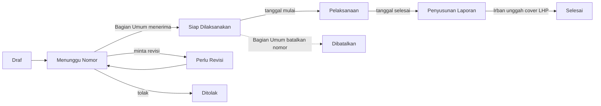

<div align="center">


# SINTAS

**Sistem Informasi Surat Tugas Pengawasan** · Inspektorat Kabupaten Muara Enim


[Gambaran umum](#gambaran-umum) · [Fitur](#fitur) · [Memulai](#memulai) · [Struktur kode](#struktur-kode) · [Deploy](#deploy)

</div>

SINTAS menggantikan Google Form, stambook fisik, dan dua sistem lama (input serta rekap/monitoring) dengan satu aplikasi web. Data SPT diinput satu kali, nomor SPT terbit otomatis tanpa duplikat, dan pimpinan memantau status pengawasan secara langsung.

## Gambaran umum

Inti sistem adalah siklus hidup SPT (Surat Perintah Tugas) yang terikat pada PKPT (Program Kerja Pengawasan Tahunan).



Nomor yang sudah terbit dapat dibatalkan Bagian Umum kapan saja, dengan alasan tertulis.

- **Irban** mengajukan nomor. **Bagian Umum** menerima, meminta revisi, atau menolak.
- Nomor terbit dari stambook digital (`Penomoran`), aman saat dua pengajuan disetujui bersamaan.
- Status setelah nomor terbit dihitung dari tanggal pelaksanaan. Irban hanya menandai Selesai.
- Penanda (Tidak Sesuai PKPT, Terlambat, dan lainnya) dihitung sistem lewat `PenandaSpt` dan `KesesuaianPkpt`.

## Fitur

- **Pengajuan dan penomoran SPT** dengan kotak masuk, register nomor, nomor manual, dan pembatalan nomor.
- **PKPT per tahun** dan **Perubahan PKPT**: Admin menyusun paket perubahan, Irban mengusulkan, Pimpinan memutuskan.
- **Monitoring dan rekap**: dasbor per peran, monitoring SPT, rekap triwulan dan tahunan. Ekspor PDF dan Excel; ekspor besar berjalan di antrean.
- **Komentar dan permintaan penjelasan** per SPT, dengan notifikasi lonceng dan email (harian dan ringkasan mingguan).
- **Halaman publik**: Beranda, Jadwal PKPT, dan Realisasi, dengan cache agregat yang disegarkan tiap tengah malam.
- **Impor data lama** (pegawai, item PKPT, SPT) dari template Excel.
- **Log aktivitas** (siapa, apa, dari IP mana), termasuk "Diinput oleh" untuk akun Irban bersama.
- **Cadangan otomatis** basis data dan berkas, terenkripsi.

> [!IMPORTANT]
> Halaman publik tidak pernah menampilkan nama pegawai, NIP, nomor SPT, objek di bawah kecamatan, kendala, komentar, atau dokumen.

### Peran pengguna

| Peran | Hak utama |
|---|---|
| Publik | Beranda, Jadwal PKPT, dan Realisasi (data terbatas), tanpa login |
| Irban | Satu akun bersama per irban. Mengajukan nomor, mengisi SPT irbannya, mengunggah dokumen, menandai Selesai, mengusulkan perubahan jadwal |
| Bagian Umum | Kotak masuk pengajuan, keputusan, register nomor, nomor manual, pembatalan nomor |
| Pimpinan | Melihat semua data, berkomentar, memutuskan Perubahan PKPT, mengekspor rekap. Tidak mengubah data SPT |
| Admin | Pengguna, master data, PKPT, Perubahan PKPT, konten halaman publik, pengaturan, impor, log |

## Memulai

### Prasyarat

- PHP 8.5.12+ dengan Composer
- Node.js 24.22.1+ (hanya untuk build aset; lihat `.nvmrc`)
- SQLite untuk lokal; MySQL 8 atau MariaDB 10.6+ di produksi

### Instalasi

```bash
composer setup                     # install, .env, key, migrate, npm install, build
php artisan migrate:fresh --seed   # data demo (lokal saja)
composer dev                       # server pengembangan
```

`.env.example` memakai SQLite, antrean `database`, email `log`, locale `id`, dan zona `Asia/Jakarta`. Ekspor besar dan email membutuhkan worker:

```bash
php artisan queue:work
```

Akun demo (kata sandi `password`, tidak dibuat di produksi): `admin`, `pimpinan`, `bagianumum`, `irban1` sampai `irban5`. Akun admin produksi dibuat dengan `php artisan sintas:buat-admin {username}`.

> [!WARNING]
> `migrate:fresh` menghapus semua data, termasuk log aktivitas. Jangan pernah menjalankannya di produksi.

### Tes

```bash
composer test
```

Tes PHPUnit ada di `tests/Feature` (per modul: Spt, Pkpt, Rekap, Ekspor, Publik, Keamanan, dan lainnya) dan `tests/Unit`.

## Struktur kode

| Folder | Isi |
|---|---|
| `app/Models` | Model inti: `Spt`, `Pkpt`, `PkptItem`, `PkptPerubahan`, `Irban`, `Pegawai`, `Tim`, `User`, `Aktivitas` |
| `app/Enums` | `Role`, `StatusSpt`, `StatusPengajuan`, `StatusPkpt`, `StatusPerubahan`, dan status lain |
| `app/Actions` | Satu kelas per aksi tulis: Auth, Spt, Pkpt, Perubahan dan Usulan PKPT, Komentar, MasterData, Konten, Profil, Pengguna |
| `app/Services` | Aturan bisnis: `Penomoran`, `PenandaSpt`, `KesesuaianPkpt`, `MonitoringSpt`, `RekapTriwulan`, `PerubahanPkpt`, `Settings`, serta `Ekspor`, `Import`, `Publik` |
| `app/Livewire` | Layar per peran: `Admin`, `BagianUmum`, `Irban`, `Pimpinan`, `Publik`, `Spt`, `Notifikasi` |
| `app/Support` | Utilitas bersama: `CachePublik`, `MingguPkpt`, `Tanggal`, `DiinputOleh`, `LabelAktivitas`, `Navigation` |
| `app/Policies` | Otorisasi per peran |
| `app/Jobs`, `app/Notifications` | Ekspor di antrean (`BuatEkspor`), notifikasi lonceng dan email |
| `app/Console/Commands` | `sintas:buat-admin`, `notifikasi:harian`, `notifikasi:ringkasan-mingguan`, `ekspor:bersihkan` |
| `resources/js` | `app.js` (dasbor, Alpine, Chart.js) dan `public.js` (halaman publik, animasi `motion`) |

### Teknologi

- Laravel 13, Livewire 4, Alpine.js, Tailwind CSS v4, Chart.js, Vite 8
- `motion` (API vanilla) hanya untuk animasi halaman publik
- `barryvdh/laravel-dompdf` (PDF), `maatwebsite/excel` (Excel), `spatie/laravel-activitylog` (log), `spatie/laravel-backup` (cadangan), `blade-ui-kit/blade-heroicons` (ikon)

### Penjadwal

Pekerjaan terjadwal (zona Asia/Jakarta) terdaftar di `routes/console.php`:

| Waktu | Tugas |
|---|---|
| 00:00 | Penyegaran cache publik |
| 00:10 | Pemangkasan cache kedaluwarsa |
| 01:00, 01:30 | `backup:clean`, `backup:run` |
| 05:00 | `ekspor:bersihkan` |
| 06:00 | `notifikasi:harian` |
| 08:00 | `backup:monitor` |
| Senin 07:00 | `notifikasi:ringkasan-mingguan` |

Di server, jalankan `php artisan schedule:run` setiap menit lewat cron.

## Deploy

Ikuti [DEPLOY.md](DEPLOY.md): kebutuhan server, konfigurasi `.env`, cron, queue worker, SMTP, cadangan dan pemulihan, reverse proxy, mitigasi keamanan PHP, dan daftar pemeriksaan setelah deploy.

> [!NOTE]
> Mitigasi CVE-2026-115560 (`public/.user.ini`) masih berlaku sampai PHP merilis tambalan. Langkah setelah tambalan ada di [NOTES.md](NOTES.md).

## Konvensi

- Antarmuka dalam Bahasa Indonesia; tanggal `d F Y`; zona waktu Asia/Jakarta.
- Status selalu tampil dengan ikon dan label (`x-app.status-badge`, `x-app.flag`), tidak hanya warna.
- Tidak ada animasi pada tabel, formulir, dan layar Bagian Umum. Semua animasi menghormati `prefers-reduced-motion`.
